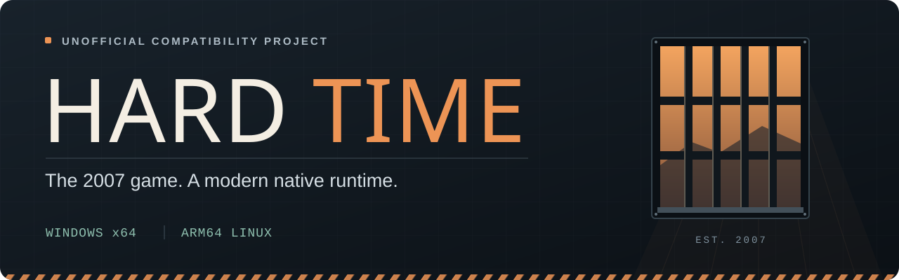
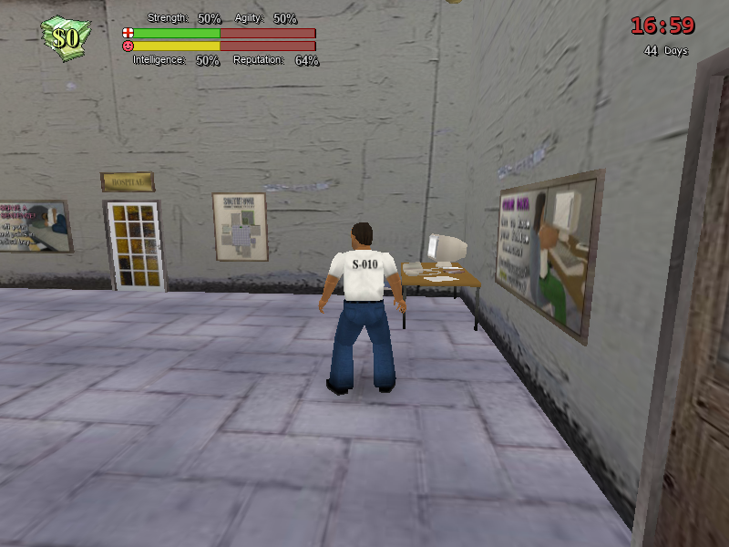
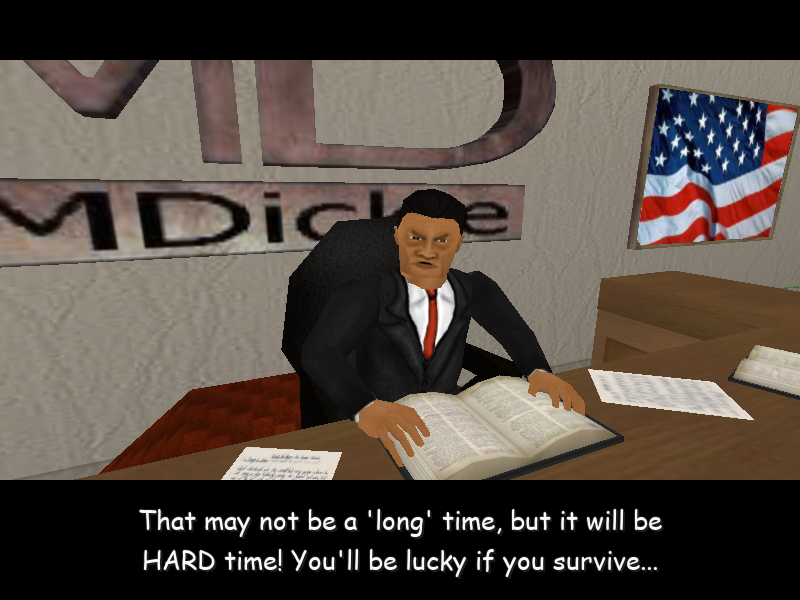
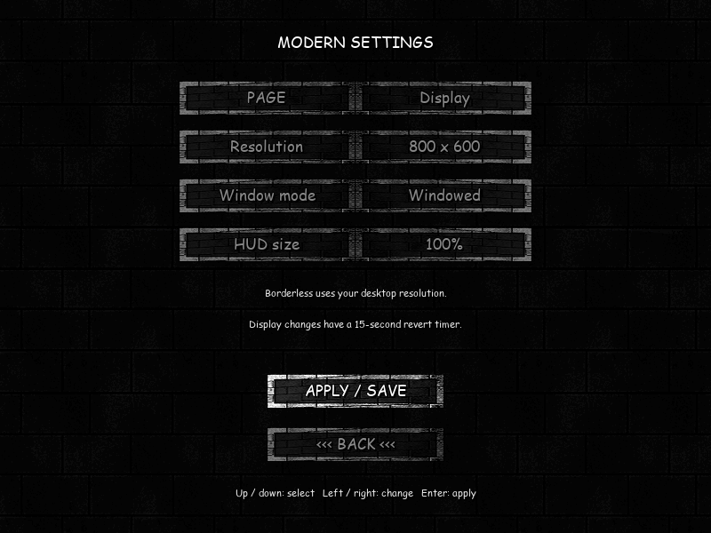
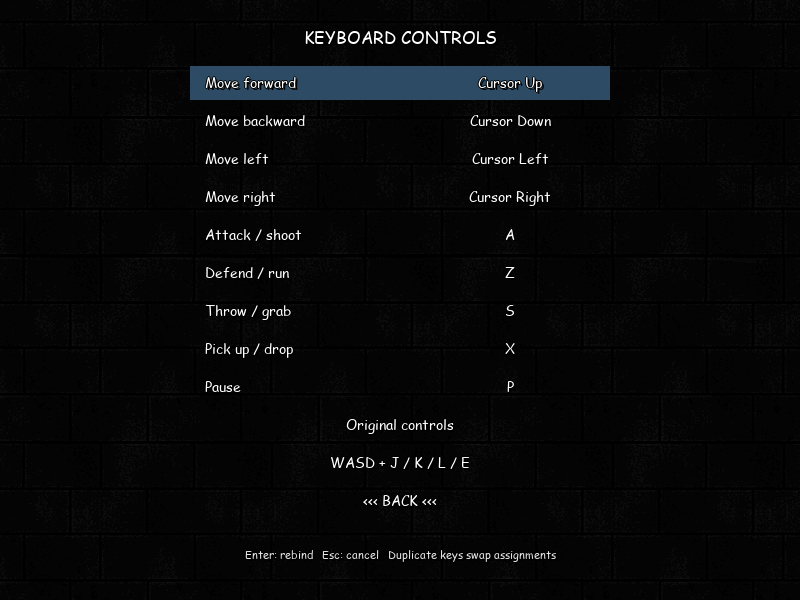
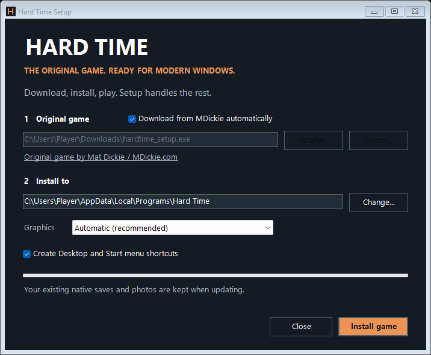

<p align="center">
  
</p>

<p align="center">
  <strong>Mat Dickie's original prison simulator, running natively on modern machines.</strong><br>
  An unofficial compatibility project, now migrating the game runtime to Rust.
</p>

<p align="center">
  <a href="#windows-setup"></a>
  <a href="#linux-setup"></a>
  <a href="#rust-migration"></a>
  <a href="#project-status"></a>
</p>

<p align="center">
  <a href="#windows-setup"><strong>Get started</strong></a> &nbsp; / &nbsp;
  <a href="#screenshots">Screenshots</a> &nbsp; / &nbsp;
  <a href="#rust-migration">Rust preview</a> &nbsp; / &nbsp;
  <a href="#whats-improved">Features</a> &nbsp; / &nbsp;
  <a href="docs/PLAY-WINDOWS.txt">Player guide</a> &nbsp; / &nbsp;
  <a href="https://github.com/EnchiladaBoy/Hard-Time/issues">Report a bug</a>
</p>

---

## Rust migration

**The new game runtime is being built in Rust.** The first preview renders nine original locations through Bevy and Direct3D 12, with a free-flying camera, display-synchronized rendering, an independent 30 Hz clock, read-only save inspection and screenshots.

This is an **environment explorer**. Characters, collision, combat, AI, missions, dialogue, audio and save-writing still need to be ported. The [Windows setup below](#windows-setup) installs the existing playable BASIC/Blitz3D build. The setup and launcher remain in C# until the Rust game is ready for them.

With the pinned Rust toolchain and Windows C++ build tools installed:

```powershell
cargo run --release --locked -p hardtime-rust -- --assets "C:\Games\Hard Time"
```

The original game folder is read only. No original assets are distributed with the preview. Packaged builds need no Rust installation; the [Rust workflow](.github/workflows/rust.yml) produces a Windows preview ZIP with dependency notices. See the [Rust guide](rust/README.txt) for controls, packaging, tests and the migration order.

## What's improved

The existing playable Windows port keeps the original game and adds a more comfortable way to play. These features describe the BASIC/Blitz3D build; the Rust preview has the smaller scope above.

| | In the native Windows build |
| :--- | :--- |
| **Display & HUD** | Desktop resolution, 1080p, 1440p and 4K; borderless mode; adjustable HUD size; automatic display-mode rollback. |
| **Controls & camera** | Rebind movement, actions and pause. Use the WASD preset, tune camera sensitivity and distance, and reconnect controllers during play. |
| **Saves & recovery** | Backups on launch, grouped save writes, damaged-settings recovery and confirmation before resetting an occupied slot. |
| **Audio** | Separate music, effects and ambience sliders. The alarm stays silent while its gameplay events still work. |
| **Rendering** | Display-refresh rendering for gameplay, menus and dialogue, with the original 30 Hz simulation. Reduced mesh/HUD work and graphics resource fixes. |
| **Everyday play** | Pause on focus loss, save on window close, an FPS counter and screenshots. |

Find the new options under **Options → Modern Settings** and **Options → Redefine Keys**. The Linux port retains its earlier feature set and the shared alarm mute.

## Screenshots

<table>
  <tr>
    <td width="50%"><a href="docs/images/gameplay.png"></a><br><sub><strong>Back inside Southtown.</strong> Original characters, environments and HUD.</sub></td>
    <td width="50%"><a href="docs/images/courtroom.png"></a><br><sub><strong>A familiar sentence.</strong> The original courtroom introduction.</sub></td>
  </tr>
  <tr>
    <td width="50%"><a href="docs/images/display-settings.png"></a><br><sub><strong>A better fit.</strong> Modern display and HUD controls.</sub></td>
    <td width="50%"><a href="docs/images/keyboard-controls.png"></a><br><sub><strong>Your controls.</strong> Full movement and action remapping.</sub></td>
  </tr>
</table>

<sub>Actual captures from the Windows port. Click to view full size. Original game artwork © Mat Dickie 2007.</sub>

## Windows setup

**One setup app. No build tools to install.** The standalone Windows installer downloads the original game from MDickie's website, adds the native build and support files, and creates a Play shortcut.

1. **[Download Hard-Time-Setup.exe (26 MB)](https://github.com/EnchiladaBoy/Hard-Time/releases/download/setup-v0.1.1-preview/Hard-Time-Setup.exe)** from the [Windows setup preview release](https://github.com/EnchiladaBoy/Hard-Time/releases/tag/setup-v0.1.1-preview).
2. Open it and click **Install game**. Setup automatically selects `hardtime_setup.exe` from Downloads when present; otherwise it offers the official download. You can also choose an original game folder.
3. Click **Play Hard Time**, or use the **Hard Time (Native)** shortcut.

<p align="center"></p>

**Windows 10 (1903 or newer) / Windows 11 x64.** Python, Git, CMake, Visual Studio and a separate 7-Zip installation are unnecessary for players. Setup uses Windows' included .NET Framework. It installs into your user folder without administrator rights; local-file installation works offline. Non-English usernames and installation paths are supported.

**Updating?** Close the game, reopen setup and choose the same native installation folder. Saves, photos and backups are preserved. Setup can recover an interrupted update, and the Play launcher backs up saves before each run.

**Graphics:** Automatic checks for an OpenGL 3.3 driver on a new installation and uses bundled Mesa when unavailable. It keeps the current renderer when updating. You can explicitly switch between GPU and compatibility graphics by rerunning setup. Software rendering can be very slow in crowded scenes; actual FPS depends on the scene and driver.

This is an unsigned preview. The release includes a SHA256 checksum and payload manifest. Original game assets are fetched from MDickie or copied from your local game; they are not included in the setup download.

**Known game issue:** Repeated F12 screenshots can darken menu graphics on the tested software renderer. Restart the game to restore them; use Windows screen capture until this is fixed. See the [validation record](provenance/windows-setup-validation.json) for test coverage and limitations.

<details>
<summary><strong>Build from source or package the installer yourself</strong></summary>

**You need:** Python 3.11+, Git, CMake, 7-Zip, and Visual Studio 2022 Build Tools with **Desktop development with C++**, Windows SDK, CMake tools/Ninja and DIA SDK. Allow roughly 15 GB for the build. The first build downloads pinned dependencies.

From PowerShell, clone the repository and build:

```powershell
git clone https://github.com/EnchiladaBoy/Hard-Time.git
cd Hard-Time
python scripts/windows.py --jobs 2
python scripts/install-windows.py --installer "$env:USERPROFILE\Downloads\hardtime_setup.exe" --software-renderer
```

Launch **`dist\Hard-Time-Windows-x64\Play Hard Time.cmd`**. The original installer is extracted without executing it, and updating an existing native installation preserves its saves and photos.

The command above uses the tested app-local Mesa software renderer. For an OpenGL 3.3-capable GPU driver, omit `--software-renderer` and use a separate destination. Software rendering can be very slow in crowded scenes; actual FPS depends on the scene and driver.

The asset directory must contain `Characters`, `Graphics`, `Sound`, `Weapons`, `World` and `Data`.

```powershell
python scripts/install-windows.py --assets "C:\Games\HardTimeOriginal" --destination "C:\Games\HardTimeNative"
```

This Python installer example uses the system's GPU driver. Add `--software-renderer` for Mesa. With the Python workflow, use a new destination when switching renderer modes, then copy your `Data` and `Photo Album` folders with both games closed. The graphical setup handles renderer changes in place.

To produce the standalone installer after building:

```powershell
python scripts/package-windows.py
python tests/test_setup_windows.py
```

The output is **`dist\Hard-Time-Setup.exe`**. See the [setup guide](setup/README.txt) for packaging, recovery, automated installation and release builds.

See the [Windows build guide](scripts/README-windows.txt) for prerequisites, tool discovery, alternate build directories and diagnostics.

</details>

### Useful keys

| Key | Action |
| :--- | :--- |
| **Arrow keys + Enter** | Navigate menus. |
| **Esc** | Save and return to the slot menu when the current conversation allows it. |
| **P** | Pause or resume by default; this binding is configurable. |
| **F11** | Toggle the rendered-FPS and simulation-rate counter. |
| **F12** | Save a screenshot to `Photo Album`. |

The WASD preset uses **W / A / S / D** for movement, **J** to attack, **K** to defend/run, **L** to throw/grab and **E** to pick up. See the [player guide](docs/PLAY-WINDOWS.txt) for settings, backups and recovery.

## Linux setup

The native ARM64 Linux workflow was validated on Fedora 44. Build on an ARM64 Linux host with OpenGL 3.3, X11/XWayland, the required fonts and the dependencies in the [Linux build guide](scripts/README.txt). From a checkout of this repository:

```bash
python3 scripts/prepare.py
scripts/build.sh
scripts/install.sh /path/to/extracted-original-game "$HOME/Games/Hard-Time-native"
```

Launch the installed `play.sh` printed by the installer. Linux uses its own build and validation record; the modern Windows settings are specific to the Windows port.

## Project status

**The compatibility build is experimental and playable; the Rust migration is an environment preview.** The compatibility build's Windows testing covers menus, character creation, the courtroom introduction, movement, save/reload, window-close saves, display switching, settings and recovery.

| Latest recorded Windows checks | Result |
| :--- | :--- |
| Runtime regressions | **19 passed** |
| Installer preservation and recovery checks | **8 passed** |
| Standalone setup recovery checks | **16 passed** |
| Packaged setup integration groups | **7 passed** |
| SDL virtual-controller reconnect check | **Passed** |

These are [recorded local results](provenance/windows-improvements-validation.json), not a live CI badge. Windows validation uses Windows 11 and Mesa llvmpipe. Physical controllers, hardware OpenGL drivers, 120/144 Hz displays and a full playthrough still need testing.

The [setup validation record](provenance/windows-setup-validation.json) also covers downloading the original from MDickie, installing through the GUI, launching the game and creating a save backup. The [Windows setup workflow](.github/workflows/windows-setup.yml) packages tagged releases from source and checks installation with synthetic asset fixtures.

<details>
<summary><strong>Run the checks and inspect the evidence</strong></summary>

After building on Windows:

```powershell
python tests/run.py --all --post-flip --software-renderer
python -m unittest discover -s tests -p test_windows_install.py -v
python tests/test_controller_windows.py
```

The tests use isolated data. The [test guide](tests/TESTS.txt) describes their coverage and the optional crowd benchmark.

- [Modern settings, recovery and performance measurements](provenance/windows-improvements-validation.json)
- [Portable Windows build hashes](provenance/windows-build.json)
- [Initial Windows compatibility checks](provenance/windows-validation.json)
- [Refresh-rate implementation and earlier measurements](provenance/windows-refresh-validation.json)
- [Historical ARM64 Linux validation](provenance/validation.json)

The crowd measurements keep AI active, so camera and dialogue changes prevent a controlled before/after speedup comparison. They do not establish a guaranteed frame rate.

</details>

## Explore the project

| Directory | What's inside |
| :--- | :--- |
| [`rust/`](rust) | New Rust core, save/model readers and Bevy environment preview. |
| [`patches/`](patches) | Game, engine and dependency corrections. |
| [`scripts/`](scripts) | Pinned source preparation, builds and local installation. |
| [`setup/`](setup) | Standalone Windows installer and Play launcher in C#. |
| [`tests/`](tests) | Runtime regressions, installer checks and profiling tools. |
| [`tools/`](tools) | Read-only analysis of the original Blitz3D module. |
| [`provenance/`](provenance) | Source revisions, hashes and validation records. |
| [`docs/`](docs) | Player instructions, technical notes and credits. |

Fetched sources and build products stay in the ignored `.work/`, `target/` and `dist/` directories. Original game files and player saves stay local.

## Credits & source

**Hard Time is © Mat Dickie 2007.** The original name, credits and noncommercial conditions are retained. This is an unofficial compatibility project.

- **Archived game source:** [softbie/hardtime-rebirth](https://github.com/softbie/hardtime-rebirth/tree/7fdfd95a71cc5b29974928b9a1151c1f3d6d0768)
- **Engine:** [Blitz3D NG](https://github.com/blitz3d-ng/package/tree/d8d5d1be34dfac328e15d9e9b831d9572cde9d0f), with this project's compatibility patches
- **Compatibility runtime:** SDL, OpenGL and OpenAL
- **Rust preview:** Bevy and wgpu, with third-party notices included when packaging

All 18 original BASIC source files are hash-pinned, and all 233 named game functions match symbols recovered from the supplied executable. The independently hosted archive establishes close correspondence; it is not represented as an authenticated original source release or a byte-identical rebuild.

See [NOTICE.txt](NOTICE.txt), the [Blitz3D license](docs/BLITZ3D-LICENSE.txt) and [source provenance](provenance/game-source.json) for the original conditions and attribution.

<p align="center"><a href="#readme">Back to top ↑</a></p>
